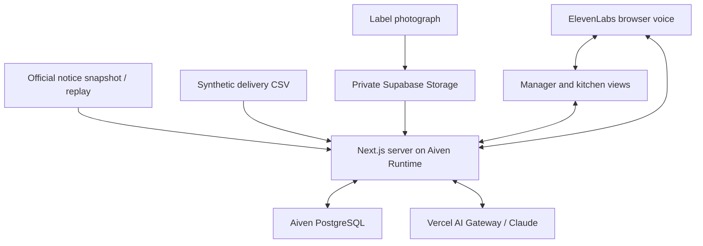

# Lotara — solo hackathon build blueprint

Prepared for the Paris AI Innovate hackathon, 22 October 2026. This is a proposed implementation and evaluation plan, not a completed application or a validated food-safety system. The builder is solo; remaining time is unspecified. Relative time budgets below are planning assumptions.

## Mandatory correction after reviewing the official challenge PDF

The official challenge requires deployment of the app to Aiven Runtime. Aiven PostgreSQL remains the canonical data layer. Vercel AI Gateway remains the model gateway, but Vercel is no longer the planned app host. This correction supersedes the earlier chat instructions about Vercel hosting.

Use a GitHub repository containing a production Dockerfile/Containerfile and, if helpful, a Compose manifest. Connect the repository in Aiven Runtime, configure runtime secrets, expose the configured HTTP port, and verify the deployed application can read and write the Aiven database. Aiven builds remotely, so installing Docker Desktop locally is optional for this workflow. Redeploy the latest commit explicitly after changes; do not assume a Git push automatically deploys it.

## 1. Product and customer hypothesis

Lotara helps a manager coordinating several nursery kitchens turn a product-recall notice into a targeted, evidence-backed response. It matches the notice against recorded deliveries, requests missing batch evidence, presents the official instructions, contacts a participating staff member, and records the response.

Opening pitch: “A food product has been recalled. Which of our kitchens received the affected batch, and has someone acted?”

Initial buyer hypothesis: an operations or food-safety lead at a catering operator serving multiple nurseries. This buyer and willingness to pay remain unvalidated. The product supports that person's work; it does not certify food as safe, diagnose contamination, or replace the operator's recall procedures.

The differentiating hypothesis is investigation of incomplete evidence and follow-through across locations. Existing food traceability and recall products mean this is not an empty market. A phone call by itself is not a durable advantage.

## 2. The exact hackathon scope

Build one protected demo workspace with three fictional kitchen locations, one historical official recall notice, a small synthetic delivery register, and label photographs. Run a real bounded tool-using investigation against Aiven PostgreSQL. Resolve one missing-label case with an actual upload. Use a real ElevenLabs browser voice session with the builder or a consenting participant. Record a staff report separately from any independent verification.

Use real notice text with its official URL, a saved source snapshot, publication time, retrieval time, and replay label. Synthetic deliveries must be visibly labeled synthetic. A replay event is not a newly published government alert.

Required outputs:

- Three-way matching: recorded match, not matching this notice, or needs evidence.
- An explanation linked to the exact notice and delivery or label evidence.
- A targeted missing-evidence request.
- Reassessment after a label upload.
- A staff contact session and an explicit action report.
- Persistent event history and measured evaluation results.

Exclude for the first build: recipe tracing, assessment of meals already served, medical advice, automatic menu substitutions, regulatory reporting, payments, nationwide live monitoring, arbitrary supplier integrations, and certification that stock has physically been removed.

## 3. Technology decisions

| Layer | Selected technology | Why it is needed |
|---|---|---|
| Application | Next.js App Router, React, TypeScript | One codebase for interface and server routes |
| Styling | Tailwind CSS, a few shadcn/ui components, lucide-react | Fast, readable interface |
| Hosting | Aiven Runtime, containerized Next.js / Node.js | Required app hosting, HTTPS endpoint and webhook routes |
| Business data | Aiven for PostgreSQL | Canonical notices, deliveries, cases, evidence, runs and responses |
| Database client | pg with parameterized SQL | Straightforward PostgreSQL access and transactions |
| Model access | Vercel AI SDK through Vercel AI Gateway | Structured extraction, image interpretation and tool use |
| Initial model | anthropic/claude-sonnet-4.6, configurable through MODEL_ID | A concrete model ID shown in current Gateway documentation; smoke-test account availability |
| Validation | Zod plus explicit matching rules in TypeScript | Validate model/tool input and separate decisions from interpretation |
| Private files | Supabase Storage, private bucket | Source documents, uploads and label photos |
| Voice | ElevenLabs Agents with @elevenlabs/react | Browser conversation without a telephone-provider dependency |
| Voice backend | @elevenlabs/elevenlabs-js | Server-side session setup and webhook verification where needed |
| Verification | Vitest; one Playwright smoke flow | Meaningful matching, state, retry and interface checks |
| Development | npm, Git, tsx, ESLint, TypeScript checker | Reproducible local workflow and pinned lockfile |

Suggested application dependencies: ai, zod, pg, @supabase/supabase-js, @elevenlabs/react, @elevenlabs/elevenlabs-js, lucide-react. Development dependencies: typescript, @types/pg, tsx, vitest, @playwright/test, ESLint and the framework's generated configuration. shadcn/ui is a component generator and may add dependencies for the specific components selected.

Choose the current supported Next.js starter and commit package-lock.json. Do not chase framework upgrades after the first successful deployment. PDF rendering or OCR libraries are not required for the first flow: use CSV for the delivery register and JPEG/PNG images for label and scanned-page interpretation. Native PDF ingestion is a later feature; do not quietly pretend an uploaded PDF was processed if it was not.

Credits are separate balances. Do not assume Anthropic credits automatically pay for Gateway-routed traffic. Check the active Gateway credential and billing route; direct Anthropic access is a fallback if Gateway billing cannot be activated. ElevenLabs' configured model and voice usage are separately metered by that service's account configuration.

Do not add Aiven Valkey, ClickHouse, OpenSearch, Modal, Lightdash, Stripe or n8n to the core merely because credits exist. Aiven PostgreSQL is the required central integration. n8n is useful later for scheduled imports and reminders; ClickHouse for genuine event analytics at scale; Valkey for measured caching/coordination needs; OpenSearch for richer document search; Modal for background extraction workloads. Lovable can help draft a design, but a separate generated application and backend would increase solo integration work. Miro is optional planning, and OpenAI is an alternative provider rather than an additional mandatory model dependency.

## 4. Architecture and execution model



The production Next.js server runs in Aiven Runtime. The browser never receives the database password, Gateway key, Supabase privileged key or ElevenLabs API key. It calls server routes. Files are uploaded using scoped upload authorization, and the server obtains short-lived private file access for interpretation.

The first version uses bounded request-driven runs: an explicit assess action, evidence upload, or verified response starts a run segment. Each segment performs a small number of tool/model steps, persists progress, and finishes at completed, needs evidence, review required, escalated or failed. It never sleeps inside a server request while waiting for a person.

Run initial structured matching in bulk with deterministic code. Start a separate bounded investigation request for each case needing interpretation, with at most one active investigation per case. Do not serialize many 90-second case investigations inside one request. For the three-site demo, only the incomplete case needs model-driven follow-up. The interface can initiate those bounded requests while open; this is not a substitute for an unattended background worker.

Suggested initial engineering limits, to be adjusted after measurement: at most six investigation tool steps per segment, a 90-second segment deadline, one transient model retry, one schema-repair attempt, and a configurable run budget. These are proposed limits, not measured performance. Use application-level request deadlines and test Aiven Runtime's actual ingress and container behavior; do not assume Vercel serverless limits apply to the container deployment.

Save each tool result and state transition before the next step. If a request fails, the case remains resumable. A visible Resume action can recover an interrupted demo run. Reliable unattended scheduling and durable workers belong to the next stage, not an unimplemented hackathon claim.

Use short polling, around every two seconds while a run is active, for the dashboard. This is application-state refresh, not a claim that official source data refreshes every two seconds. No WebSocket infrastructure is required for this demo.

## 5. Accounts and preflight

Complete these before cosmetic interface work:

1. Activate Aiven credits; create a small PostgreSQL service in an appropriate EU region. Obtain the host, port, database, application credentials and project CA certificate. Verify a server-side SELECT 1 with certificate verification.
2. Activate Vercel AI Gateway access, choose the credential route, and run a small structured text test and a label-image test. Confirm the actual model ID is available in the account. Separately connect the project GitHub repository in Aiven Runtime and deploy a minimal container before feature work.
3. Create a private Supabase bucket. Test an authorized upload and signed download; verify an unauthenticated download fails.
4. Configure one ElevenLabs agent. Start a browser conversation, test the microphone, obtain a short-lived session authorization server-side, and verify an event reaches a deployed endpoint.
5. Obtain one official notice with a readable batch criterion and official URL. Save the raw source and retrieval timestamp. Select a different notice if its scope cannot be represented unambiguously in the prototype.
6. Deploy a plain page and a database-backed status route. Confirm public webhook endpoints are reachable while protected management routes remain protected.

Timebox a blocked integration to 20–30 minutes before using the listed fallback. Documentation has been inspected for this blueprint; the actual account credentials, runtime connectivity and full integrations have not been tested here. A direct sample API fetch in this environment was blocked by network restrictions, so raw upstream field mapping remains a preflight task.

## 6. Canonical data model

All business records carry tenant_id, created_at and appropriate actor/source fields. PostgreSQL is authoritative; Supabase stores files only. A single tenant is sufficient for the exercise, but every data query still scopes tenant and site.

| Table | Main fields / responsibility |
|---|---|
| sites | id, tenant_id, name, demo contact identity |
| documents | id, tenant_id, storage_path, mime_type, sha256, uploaded_by, created_at |
| recall_versions | id, source_id, source_version, source_url, raw_payload JSONB, normalized_scope JSONB, published_at, retrieved_at, content_hash, review_status |
| received_lots | id, tenant_id, site_id, supplier, product_name_raw, gtin_raw, lot_raw, normalized identity fields, received_at, quantity, unit, source_document_id |
| evidence_items | id, tenant_id, case_id, document_id, field_name, raw_value, interpreted_value, page_or_region, extraction_status, confirmed_by |
| cases | id, tenant_id, recall_version_id, site_id, received_lot_id, match_status, response_status, reason_codes, evidence references, version |
| evidence_requests | id, case_id, requested_fields, request_text, status, created_at, fulfilled_at |
| investigation_runs | id, case_id, status, step_count, deadline, model_id, prompt_version, started_at, finished_at |
| run_steps | id, run_id, step_index, tool_name, input JSONB, output JSONB, elapsed_ms, usage JSONB, status |
| contact_attempts | id, case_id, channel, conversation_id, status, initiated_by, started_at, finished_at |
| staff_reports | id, case_id, actor_id, reported_action, quantity_if_known, unit, supporting_evidence, reported_at, confirmation_method |
| event_log | id, tenant_id, case_id, event_type, source, idempotency_key, payload JSONB, occurred_at, received_at |

A small implementation can merge evidence_requests into case JSONB or combine run_steps and event_log, provided it preserves the same semantics. Do not spend the day implementing an elaborate enterprise schema.

Useful indexes: received_lots(tenant_id, gtin_normalized), received_lots(tenant_id, site_id, lot_normalized), cases(tenant_id, recall_version_id, match_status), event_log(case_id, occurred_at), plus the unique idempotency key.

Use a unique case key over tenant, recall version, site and received-lot record. Use a unique event key over provider/source and event identity; where a provider has no event ID, derive a documented key from immutable fields or a raw payload hash. Do not generate a new random deduplication key on each retry.

Update case state and append its event in one transaction. Use optimistic version checks so an old investigation cannot overwrite newer evidence. Save original evidence; do not replace it with a model summary. Restrict application audit-log permissions to insert/read where practical, but describe this as an application audit trail, not inherently immutable or tamper-proof storage.

## 7. Matching and uncertainty

The model extracts and explains. Explicit code evaluates normalized recall predicates. A model confidence number is not sufficient evidence to clear a batch.

Matching inputs include product identity, GTIN where provided, exact batch or explicitly defined batch scope, date criteria where applicable, and any other restrictive notice terms supported by this prototype. A broad “all batches” notice must be represented explicitly; a missing batch value is never interpreted as “all batches.”

Normalization preserves original values. Keep GTINs as strings with leading zeroes. Validate the expected format/check digit where relevant. Trim obvious whitespace; apply case normalization only when appropriate for the identifier. Do not automatically treat O as 0, I as 1, remove meaningful punctuation, or equate two lot codes because they look similar. Normalize units only with an explicit conversion rule.

Match status:

- RECORDED_MATCH: sufficiently confirmed evidence satisfies every applicable recall criterion. This means the recorded lot matches, not that current physical stock or contamination has independently been proved.
- NOT_MATCHING_THIS_NOTICE: complete evidence establishes exclusion under the selected notice. Display that precise phrase, never “safe.”
- NEEDS_EVIDENCE: product, batch, date, conflicting records, or scope cannot be resolved. A potential match remains visible and cannot be cleared by a convenient guess.

Response status is separate: NOT_REQUESTED, REQUESTED, STAFF_REPORTED_ACTION, REVIEWED_COMPLETE or ESCALATED. A good match does not imply a staff response; a staff response does not prove a good match.

Critical image-extracted identifiers are shown beside the original crop for explicit confirmation in the prototype. Clear extraction from a trusted structured register can be treated differently from uncertain OCR, but do not invent calibrated certainty. A contradictory photo or subsequent record reopens review rather than silently overwriting the earlier claim.

Historic delivery does not prove an item is still in stock. Ask staff to check. Do not infer no risk merely because a quantity field is zero or a delivery is old. Source changes or expanded batch lists trigger reassessment; decisions remain tied to their source version.

## 8. Agent tools and control loop

Give the investigation agent a narrow objective: “Resolve this case using cited evidence, or identify the specific evidence still required.”

Allowlisted tools:

| Tool | Effect |
|---|---|
| get_recall_scope(recall_version_id) | Returns the reviewed notice criteria and source references |
| find_received_lots(product_query) | Searches tenant-scoped recorded deliveries |
| get_case_evidence(case_id) | Returns available documents and confirmed/unconfirmed fields |
| extract_label(document_id) | Interprets one permitted image into a validated schema |
| evaluate_match(case_id) | Deterministic evaluation; cannot be overridden by a model verdict |
| request_evidence(case_id, fields, reason) | Creates a scoped request linked to missing predicates |
| propose_contact(case_id, reason) | Creates a contact proposal for the demo participant |
| get_response_status(case_id) | Retrieves the persisted response state |
| finish_investigation(case_id, summary) | Saves a cited summary after rule validation |

The server supplies tenant/site scope. Never let the model choose arbitrary tenants, recipients, SQL statements or URLs. Tool parameters are validated with Zod. The model gets minimum necessary evidence, not the entire database or credentials.

Illustrative loop: inspect recall scope; fetch deliveries; inspect evidence; call evaluator; if a lot is missing, create a label request and stop; when a photo arrives, resume using persisted context; extract and confirm the critical identifier; re-evaluate; prepare the supported next action.

Treat documents and transcripts as data. Instructions embedded in them cannot change the system's permissions or objective. Log tool names, factual results and concise decision summaries, not private chain-of-thought.

A single investigator plus a voice agent and a deterministic verifier is enough. Separate parser/auditor/negotiator agents are not necessary. The evidence-dependent tool selection, wait/resume behavior and outcome checks demonstrate agency.

## 9. Voice and staff confirmation

Use a browser voice session as the core implementation. The participant opens a kitchen-specific demo page and starts the conversation after microphone permission. The interface identifies it as an AI demo agent. A telephone call is an optional upgrade requiring an activated telephony integration and a consenting test number.

The voice agent receives only the current case's approved facts, source reference, requested confirmation and participant scope. It reads official instructions accurately or points to the notice. It must not improvise medical advice, certify safety, invent quantities or say an action happened before a person reports it.

Keep voice mutations narrow. A spoken report becomes an unverified or participant-reported event, not independent proof. Present a short confirmation card in the authenticated participant view so the person can confirm or correct the interpreted report. A speech-to-text mistake must not close a case automatically.

Use a server-issued short-lived voice session authorization; verify post-call webhook signatures over the raw request body using the ElevenLabs SDK. Validate conversation ID against the session mapping. Deduplicate webhook delivery and tolerate a late transcript. A transcript summary alone cannot invent a new completion event.

Example staff report: “Participant reported that two cartons were set aside according to the notice at 14:12.” Distinguish from “independently inspected and removed.” Quantity is optional when not known; never manufacture a number to fill a schema.

## 10. Interface and server contracts

Build three views, not an open-ended chatbot:

1. Response overview: source version and timestamps; counts of recorded matches, needs-evidence cases and response states; a site/case table; a last-update indicator; a visible replay/synthetic-data banner.
2. Case workspace: official scope; delivery evidence; label image; missing fields; reason codes; evidence request; upload and confirmation controls; contact action; event timeline.
3. Kitchen response: minimal notice context, official instructions, requested stock check, voice control and explicit report confirmation.

Use text and icons as well as color. Reserve success styling for a clearly named completed administrative state. An attractive graph is optional; a readable evidence table and timeline are sufficient.

Suggested routes:

- POST /api/demo/reset — protected, resets only the isolated synthetic demo namespace.
- POST /api/recalls/import — normalizes a supplied official snapshot or authenticated import result.
- POST /api/deliveries/import — validates a small CSV and reports rejected rows.
- POST /api/cases/assess — starts a bounded run over the chosen exercise.
- POST /api/cases/:id/investigate — advances one ambiguous case, separately from bulk structured assessment.
- GET /api/cases and GET /api/cases/:id — return tenant-scoped state.
- POST /api/uploads/authorize — returns scoped upload authorization.
- POST /api/cases/:id/evidence — registers a finished upload and triggers reassessment.
- POST /api/evidence/:id/confirm — records critical-field confirmation with actor identity.
- POST /api/voice/session — creates authorized case/session context.
- POST /api/webhooks/elevenlabs — verifies, persists and deduplicates external events.
- POST /api/cases/:id/staff-report — accepts an authenticated participant's report.
- POST /api/cases/:id/resume — resumes an interrupted run from its last checkpoint.
- GET /api/evaluation/latest — displays saved evaluation results, not invented numbers.

For one protected demo workspace, a server-validated demo login with a secure HTTP-only session is sufficient. Use separate site-scoped participant tokens for kitchen pages. For production, add real identity, roles, organization membership and session management. Never trust an actor_id or tenant_id submitted by the browser as authorization.

Suggested source layout:

```text
Dockerfile                   production Next.js container for Aiven Runtime
.dockerignore                excludes secrets, dependencies and development artifacts
app/                         pages and API handlers
components/                  case table, source card, evidence panel, voice panel
lib/db.ts                    pg pool and transactions
lib/auth.ts                  demo sessions and participant scoping
lib/storage.ts               private upload/download helpers
lib/recalls/adapter.ts        upstream-to-canonical mapping
lib/recalls/scope.ts          scope validation
lib/matching/normalize.ts     conservative identifier normalization
lib/matching/evaluate.ts      deterministic predicates
lib/agents/investigate.ts     bounded tool loop
lib/agents/tools.ts           validated allowlist
lib/voice.ts                 session and verified webhook handling
lib/events.ts                idempotency and transactional state changes
db/migrations/               SQL schema
scripts/seed.ts              deterministic demo data
scripts/evaluate.ts          benchmark runner
fixtures/development/        synthetic examples and source snapshots
fixtures/holdout/            held-out examples; gold labels withheld from agent
tests/                       matching, state, auth, webhook and browser checks
```

Environment variables: AIVEN_DATABASE_URL; AIVEN_CA_CERT_BASE64; AI_GATEWAY_API_KEY; MODEL_ID; SUPABASE_URL; SUPABASE_SERVICE_ROLE_KEY or the currently supported equivalent server secret; SUPABASE_BUCKET; ELEVENLABS_API_KEY; ELEVENLABS_AGENT_ID; ELEVENLABS_WEBHOOK_SECRET; APP_BASE_URL; DEMO_ADMIN_PASSWORD_HASH; SESSION_SECRET; PARTICIPANT_TOKEN_SECRET. These are variable names, not credentials. Never put server secrets in NEXT_PUBLIC variables. Do not log connection strings or signed URLs.

## 11. Solo build order and stopping rules

The following six-hour reference budget assumes several working hours remain. Reallocate to the actual deadline; do not use it as a promise of completion.

| Elapsed work | Deliverable and gate |
|---|---|
| 0:00–0:30 | Account preflight, select notice, freeze three-site story, deploy plain app |
| 0:30–1:15 | Aiven schema, seed records, DB-backed case table, deterministic matching |
| 1:15–2:15 | Private label upload, structured extraction, identifier confirmation, reassessment |
| 2:15–3:15 | Bounded investigator, real evidence requests, checkpoints and cited summaries |
| 3:15–4:00 | ElevenLabs browser voice and authenticated staff report |
| 4:00–5:00 | Benchmark, failure cases, duplicate/reload handling and interface polish |
| 5:00–6:00 | Deployment verification, timed rehearsals, measured-result slide and fallback recording |

Every gate produces an end-to-end usable slice. Do not build all the UI before the first real database query. If the core is late, cut voice before cutting matching and evidence handling. If time is very short, use one notice, three delivery rows, one label image and typed staff confirmation; describe the result honestly as a reduced prototype.

With extra time, prioritize one real operator interview and observed usability feedback before another database integration. Then add n8n reminders or telephony if they improve the demonstrated workflow.

## 12. Evaluation that supports credible claims

Create 30 synthetic cases across a small range of reviewed notice scopes: exact matches, explicit exclusions, same-brand/different-product records, missing lot fields, conflicting evidence, duplicate deliveries and source updates. Use about 12 development cases and 18 held-out cases. Keep gold labels outside agent-visible context. Count duplicated/replayed copies separately from unique matching examples when reporting results.

Ground truth is the expected interpretation of the constructed evidence, not proof of real contamination or biological safety. Evaluate both before and after missing evidence is supplied. Do not punish correct initial uncertainty as if the agent should have guessed a hidden batch.

Baselines:

- Product-name matcher: shows the cost of broad name-level alerts.
- Structured exact matcher with unknowns: shows what deterministic rules already achieve.
- Full investigation: tests whether targeted evidence requests resolve more unknowns with appropriate human effort.

Metrics:

- Recorded-match precision = correct confirmed record matches / all record matches declared.
- Triage recall = affected ground-truth cases flagged as recorded match or needs evidence / all affected cases. Report separately from confirmed-match recall.
- Incorrect exclusion rate = affected cases wrongly marked not matching / all affected cases.
- Evidence-resolution rate = initially unresolved cases correctly resolved after requested evidence / initially unresolved cases supplied with sufficient evidence.
- Human touches and elapsed human handling time for the same exercise.
- Detection and processing latency measured from application ingestion; official publication-to-ingestion delay is a separate metric.
- Staff-acknowledgment latency is separate from reported action and any later managerial review.
- Model usage, voice duration and observed or explicitly estimated cost per case.
- Repeated callbacks that create duplicate contact attempts or reports.

Use full counts such as 17/18, not impressive percentages alone. A zero-error small test does not establish real-world zero-error operation. If results miss the proposed target, present the failure and the correct uncertainty behavior rather than hiding it.

Proposed engineering acceptance gates: all known ambiguous fixtures remain unresolved until sufficient evidence arrives; duplicate events do not duplicate completed effects; an invalid webhook signature changes no case state; a staff transcript cannot independently set REVIEWED_COMPLETE; tenant/site checks hold; and the complete three-site demo works after a page reload. These are targets until executed.

Meaningful tests include exact and broad-scope recalls; missing fields; leading zero preservation; OCR O/0 confusion; contradictory records; source-version expansion; duplicate callbacks; stale state writes; forged events; cross-site access; a document containing instructions to ignore the recall; and resume after an interrupted run.

## 13. Likely challenges and responses

| Challenge | Response |
|---|---|
| Source freshness uncertain | Show publication/retrieval timestamps, retain snapshots, use honest historical replay |
| API unavailable | Use the saved official notice snapshot and label source freshness visibly |
| Raw source fields change | Keep one adapter and raw JSON; validate before importing; unsupported criteria require review |
| Missing or unreadable lot | Request a targeted photo; preserve unresolved status |
| Name or packaging ambiguity | Treat similarity as candidate discovery, not identity confirmation |
| Delivery record mistaken for current inventory | Ask staff to check physical stock; preserve historical-evidence wording |
| Model emits invalid data or loops | Validate schema; bounded retry, step/time/cost limits; persist failure state |
| Person says only part was removed | Record a partial report; remaining uncertainty stays open |
| Voice service or microphone fails | Use typed confirmation; label any fallback recording as prerecorded |
| Browser closes mid-run | Resume from Aiven checkpoint; do not imply unattended worker guarantees |
| Duplicate or late events | Idempotent inserts, version checks and source timestamps |
| Sensitive uploads exposed | Private bucket, scoped signed access and server-side authorization |
| Too much solo integration work | Cut optional services; keep one primary database and one investigator |

## 14. Demo and pitch

Suggested 150-second sequence: 20 seconds for the operations-manager problem; 20 seconds for source and three sites; 35 seconds for real assessment and missing evidence; 25 seconds to upload and confirm the batch label; 30 seconds for a staff voice/report interaction; 20 seconds for the measured benchmark and pilot customer hypothesis. Rehearse actual duration and shorten to the organizer's limit.

Opening: “This recall names a batch, not every product with the same brand. We help a multi-site kitchen operator work out where that batch went and coordinate the response.”

Explain Aiven through the observed workflow: it connects source versions, batch records, evidence, case state and staff reports. Show real persisted events and queries in a development drawer if asked; keep implementation detail out of the normal kitchen interface.

Do not claim to have prevented an actual incident, made food safe, independently verified physical removal or achieved real-world resolution-time savings using synthetic data. State the tested result: a replayed official notice, synthetic delivery records, a real evidence-dependent agent workflow and measured prototype performance.

## 15. From prototype to a possible startup

First validate with an operator who owns this workflow. Ask for permission to examine a historical recall drill or anonymized delivery records. Observe the existing procedure, the missing data, who contacts sites, how responses are evidenced and what incumbent software already does.

A sensible pilot is a supervised recall exercise with historical data. Measure missed sites, false alerts, human effort, evidence completeness and time to acknowledgment. Keep the operator's procedures and authority in place. Test a paid continuation only after useful results are demonstrated.

Productization requires reliable source monitoring, durable background workers, reviewed adapters, real role-based access, tested recovery, retention controls, staff onboarding, operational ownership, independent validation and a clear integration strategy. Batch-level data capture may be the largest adoption cost. If customers cannot supply the evidence economically or existing tools already solve the problem adequately, the commercial hypothesis needs revision.

## 16. Sources checked

- RappelConso official open-data documentation: https://rappel.conso.gouv.fr/support/open-data
- Official GTIN dataset/API console: https://data.economie.gouv.fr/explore/dataset/rappelconso-v2-gtin-trie/api/
- Aiven PostgreSQL Node.js connection and certificate example: https://aiven.io/docs/products/postgresql/howto/connect-node
- Vercel AI Gateway SDKs and APIs: https://vercel.com/docs/ai-gateway/sdks-and-apis
- Aiven Runtime deployment: https://aiven.io/docs/products/runtime/deploy-apps
- Next.js container deployment: https://nextjs.org/docs/app/getting-started/deploying
- Supabase private storage access: https://supabase.com/docs/guides/storage/buckets/fundamentals
- ElevenLabs React SDK: https://elevenlabs.io/docs/eleven-agents/libraries/react
- ElevenLabs tools: https://elevenlabs.io/docs/eleven-agents/customization/tools
- ElevenLabs signed post-call webhooks: https://elevenlabs.io/docs/eleven-agents/workflows/post-call-webhooks
- n8n webhook and wait behavior, relevant to a later scheduler: https://docs.n8n.io/integrations/builtin/core-nodes/n8n-nodes-base.webhook/ and https://docs.n8n.io/integrations/builtin/core-nodes/n8n-nodes-base.wait/
- Existing traceability/recall products: https://www.fooddocs.com/food-traceability and https://foodready.ai/features/recall-management-software/


## Official brief alignment check

Reviewed all three pages of the supplied Future Founders: Data-Centric Agents brief. The product fits the customer, agent and data criteria in concept. The working implementation must still demonstrate them.

- Deploy the application to Aiven Runtime; do not substitute Vercel hosting.
- Use Aiven PostgreSQL to drive matching, evidence history, state changes and response tracking.
- Demonstrate genuinely changing application data: upload a label, trigger reassessment, and persist the response. Source polling or a replay timer alone is insufficient to show useful freshness.
- Use a real official recall source and clearly identify synthetic deliveries and historical replay. Never describe a replay as a newly published live alert.
- Show the complete user journey and a measured comparison against a name-only or no-evidence baseline.
- Include one pitch slide naming the user, why now and the first-user route.
- Use only data safe to share publicly.
- One agent is sufficient; the inspiration examples do not require implementing every agent pattern.
- Aiven's best-use prize is separate from the overall judging criteria. The PDF does not supply detailed submission mechanics or a deadline; use the organizer's current event instructions for those.
