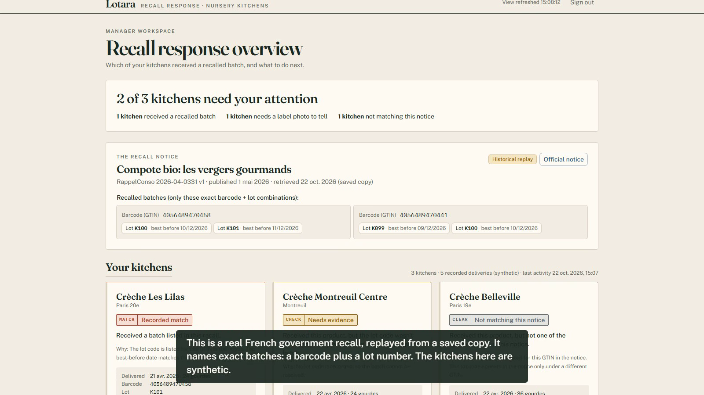
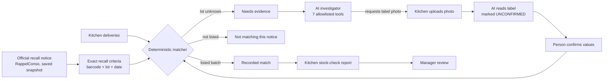
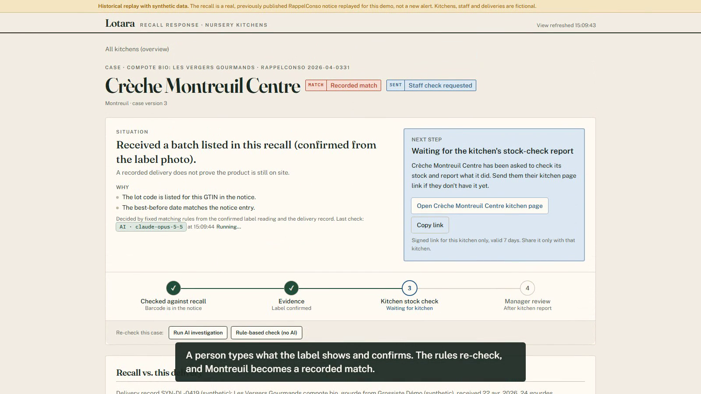
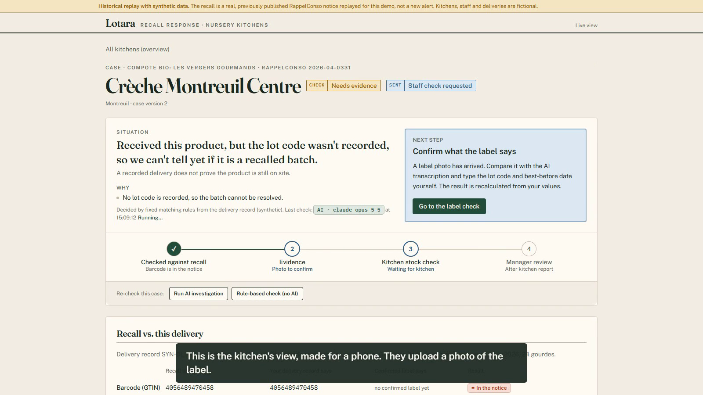
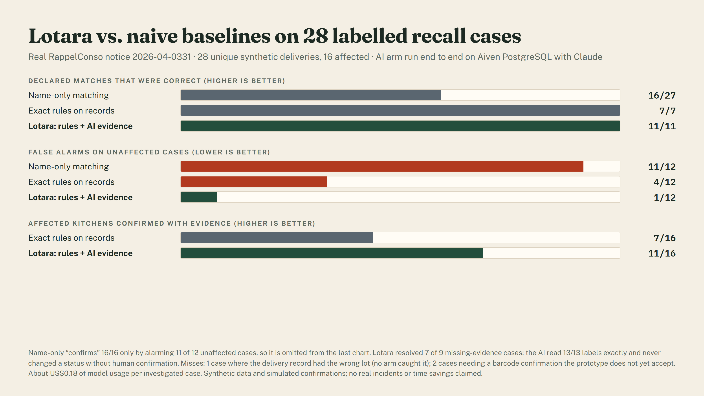

# Lotara

**Recall response for nursery kitchens.** A food recall names exact batches: a barcode and a lot number. Lotara finds which kitchens received an affected batch, sends an AI investigator to collect the evidence that is missing, and tracks every kitchen's confirmed response until a manager closes the case.

Built for the Paris AI Innovate hackathon (October 2026). Hosted on **Aiven Runtime** with **Aiven for PostgreSQL**; the AI runs on **Claude** through the Anthropic API.

| | |
|---|---|
| Live site (no login) | [lotara on Aiven: /welcome](https://01a16320-7504-70fc-b08b-06bc2a4c1c84-8080.eur-1.aiven.app/welcome) |
| Manager demo | [/login](https://01a16320-7504-70fc-b08b-06bc2a4c1c84-8080.eur-1.aiven.app/login) (demo password shared with judges) |
| 3-minute demo video | [docs/submission/lotara-demo.mp4](docs/submission/lotara-demo.mp4) |
| Pitch slide | [PNG](docs/submission/slide.png) · [PPTX](docs/submission/lotara-pitch.pptx) · [PDF](docs/submission/slide.pdf) |
| Measured results | [docs/RESULTS.md](docs/RESULTS.md) |



> This is a prototype, not a food-safety system. It never certifies food as safe and does not verify that stock was removed. The recall notice is real and replayed from a saved copy; kitchens, staff and deliveries are synthetic.

## The problem

When a product is recalled, an operations lead coordinating several nursery kitchens has to answer one question fast: **which of our kitchens received the affected batch, and has someone acted?**

- Recalls list batches, not brands. Searching by product name flags every kitchen that ever bought the product.
- Lot codes are often not written down at delivery, so the honest answer is "unknown" until someone checks the label.
- Follow-up across sites happens by phone, with no record of who checked what.

## How it works



1. **Notice in.** A real French government recall (RappelConso 2026-04-0331, compote bio) is saved with its publication and retrieval times and normalised into exact (barcode, lot, best-before) entries.
2. **Exact matching.** Deterministic rules compare every recorded delivery with those entries and write one case per kitchen: *Recorded match*, *Not matching this notice* or *Needs evidence*.
3. **AI investigation.** For a case with missing information, an AI agent works through seven allowlisted tools scoped to that single case. It reads the criteria and the delivery record, runs the matcher, and asks that kitchen for a label photo naming exactly the fields it needs.
4. **Evidence.** The kitchen uploads a photo from its phone. The AI transcribes it, marks every value as unconfirmed, and flags look-alike characters such as O and 0. A person types what the label shows; the rules re-check the case.
5. **Response.** The kitchen sends a typed stock-check report (recorded once, even if sent twice). Only the manager can mark the case *reviewed complete*.

| Case workspace | Kitchen page |
|---|---|
|  |  |

## What the AI may and may not do

The model is useful because it is constrained.

- **It chooses tools; it never decides status.** Only the deterministic matcher writes *Recorded match*, *Not matching this notice* or *Needs evidence*. The investigator's final summary is rejected if it contradicts the matcher, cites evidence a tool did not return, or calls a product "safe".
- **Unconfirmed is unconfirmed.** A label transcription never changes a case until a person confirms the values. The confirmation form is never pre-filled from the model.
- **Narrow, scoped tools.** `get_recall_scope`, `get_delivery_record`, `get_case_evidence`, `extract_label`, `evaluate_match`, `request_evidence`, `finish_investigation`. Inputs are validated with Zod. Tenant and case come from the server, never from the model. No SQL, no URLs, no credentials.
- **Bounded runs.** At most 8 tool calls, 8 model turns and 120 seconds per segment, with automatic segments capped per case. Every model turn and tool call is persisted with timing, tokens and estimated cost.
- **Kitchen-facing text is a server template.** Model output is shown only to the manager.

## Measured results

28 unique synthetic delivery cases against the real notice, 16 of them affected (dev/holdout split, gold labels kept separate from the agent). The AI arm ran end to end on the real database with Claude.

| | Name-only matching | Exact rules on records | Lotara: rules + AI evidence |
|---|---|---|---|
| Declared matches that were correct | 16/27 | 7/7 | **11/11** |
| False alarms on unaffected cases | 11/12 | 4/12 | **1/12** |
| Affected kitchens confirmed with evidence | 16/16 (by flagging almost everything) | 7/16 | **11/16** |
| Missing-evidence cases resolved | n/a | n/a | **7/9** |

The AI transcribed 13 of 13 labels exactly and never changed a status without human confirmation. Model usage was about US$0.18 per investigated case. Misses are listed individually in [docs/RESULTS.md](docs/RESULTS.md), including one affected case no arm caught (the delivery record had the wrong lot) and two cases that need a barcode confirmation the prototype does not accept yet. Synthetic data, simulated confirmations and a single notice: these are prototype measurements, not real-world performance.



## The data layer on Aiven

Everything lives in one Aiven for PostgreSQL database, in the `lotara` schema ([db/migrations](db/migrations)):

| Table | Holds |
|---|---|
| `recall_versions` | Raw notice snapshot, normalised criteria, publication and retrieval times |
| `received_lots` | Recorded deliveries per kitchen, with original and normalised identifiers |
| `cases` | One case per kitchen and notice: match status, response status, reasons, version |
| `documents`, `label_extractions`, `evidence_items` | Private label photos, raw AI transcriptions, human-confirmed values |
| `evidence_requests`, `staff_reports`, `contact_attempts` | What was asked of each kitchen and what it reported |
| `investigation_runs`, `run_steps` | Every AI segment, model turn and tool call with usage and cost |
| `event_log` | Audit trail; each state change is written in the same transaction |

The app connects with TLS certificate verification against the Aiven project CA (`sslmode` parameters in the URL are deliberately ignored). Optimistic version checks stop a stale update from overwriting newer evidence.

## Tech stack

Next.js 16 (App Router, server actions, Cache Components) · TypeScript · Tailwind CSS v4 · `pg` · `@anthropic-ai/sdk` (model `claude-opus-5-5`, configurable) · Zod · Vitest · Playwright · Docker (standalone output, non-root, port 8080) · Aiven Runtime · Aiven for PostgreSQL.

## Run it locally

1. `npm ci`
2. Create `.env.local` (git-ignored) with `AIVEN_DATABASE_URL`, `AIVEN_CA_CERT_PATH=certs/aiven-ca.pem` (save the project CA there; also ignored) and optionally `ANTHROPIC_API_KEY`. See [.env.example](.env.example).
3. `npm run setup:secrets` prompts for a demo admin password (not echoed) and writes its hash and the session secrets. Flags: `--upgrade-hash`, `--export`, `--rotate`.
4. `npm run db:check` (SELECT 1 over verified TLS), then `npm run db:migrate`.
5. `npm run dev`, sign in, click **Reset demo**.

Without an API key, the AI actions report "unavailable" and a clearly labelled rule-based check still works.

## Tests and evaluation

| Command | What it does |
|---|---|
| `npm test` | Unit tests, the real-database flow test (isolated tenant) and the deterministic evaluation arms. No paid calls. |
| `RUN_AI_TESTS=1 npm test` | Adds the real AI investigator flow test. |
| `npm run test:e2e` | Playwright journey in an isolated `e2e` tenant. `E2E_AI=1` uses the real model. |
| `npm run eval` | Full benchmark: name-only, exact rules, and AI with evidence collection. Writes [docs/RESULTS.md](docs/RESULTS.md). |
| `npm run ai:smoke` | One small text call and one vision call. |

## Deploy to Aiven Runtime

Connect this repository, build from the `Dockerfile`, expose port **8080**, and connect the PostgreSQL service (it provides `DATABASE_URL`). Set `AIVEN_CA_CERT_BASE64`, `ANTHROPIC_API_KEY`, `DEMO_ADMIN_PASSWORD_HASH`, `SESSION_SECRET` and `PARTICIPANT_TOKEN_SECRET` as secrets (raw values from the ignored `secrets/aiven-runtime-secrets.txt`). Pushing does not deploy: choose **Deploy latest commit**, then check `/api/health` for the `release` and a configuration summary that never shows values.

## Repository map

```
app/            pages, server actions, /api/health, private image route, public /welcome
components/     UI: kitchen cards, comparison table, label evidence, AI run steps
lib/matching/   conservative normalisation and the deterministic matcher
lib/recalls/    RappelConso adapter and recall scope
lib/ai/         Anthropic client, label extraction, bounded investigator
lib/eval/       evaluation arms, metrics and report
db/migrations/  SQL schema
fixtures/       saved notice snapshot, evaluation cases and gold labels
scripts/        migrations, secrets setup, evaluation, demo-video recorder
docs/           results, demo script, pitch slide, submission material
```

## Limitations and next steps

- Synthetic kitchens and a single replayed notice; the buyer and willingness to pay are unvalidated hypotheses.
- Barcodes read from photos cannot be confirmed yet (two evaluation misses).
- No unattended background worker or live recall monitoring; voice contact is deferred.
- Next: a supervised recall drill on historical deliveries with one multi-site nursery caterer, measuring missed sites, false alerts and time to staff acknowledgment.

More: [demo script](docs/demo-script.md) · [pitch slide content](docs/pitch-slide.md) · [Lovable design prompt](docs/lovable-prompt.md) · [blueprint](Blueprint.md)
